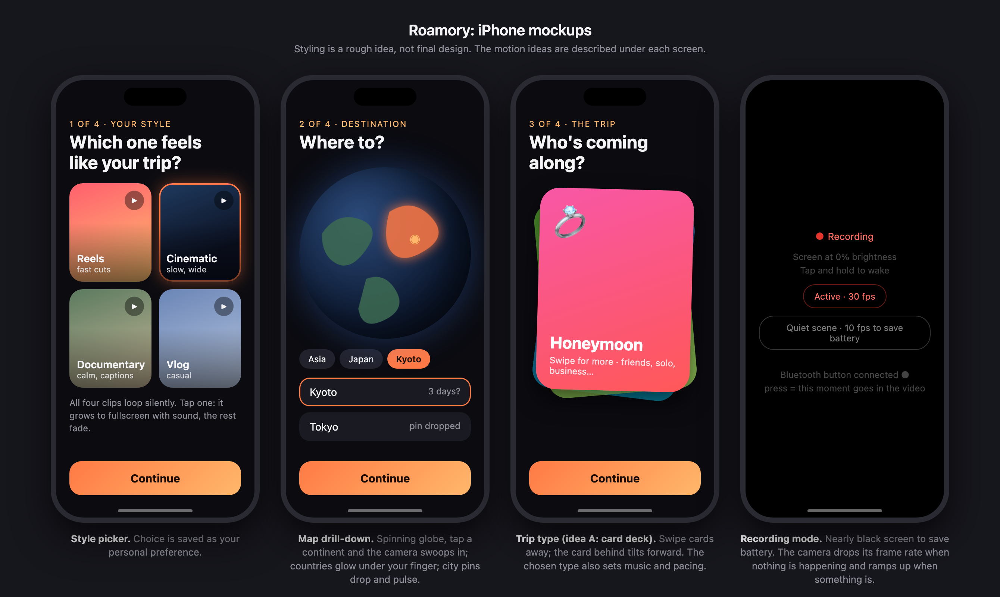

# Roamory (AI Travel Videographer)

Hackathon MVP: an iPhone app that learns your video style and trip, films with the screen dark and an adaptive frame rate, keeps the moments that matter (a Bluetooth button guarantees one), and auto-edits a highlight video. Cloud AI selects the moments.

*Rough mockups: style picker, map destination, trip type, recording mode. Source: [docs/mockups/iphone-screens.html](docs/mockups/iphone-screens.html).*

Specs live in `docs/`: [PRD](docs/PRD.md) · [TRD](docs/TRD.md). Both are updated for the iPhone pivot.

## Repo layout

| Folder | What | Owner |
| --- | --- | --- |
| `ios/` | iPhone app: onboarding, camera capture with adaptive frame rate, rolling buffer, Bluetooth button, review screen (native Swift assumed; not yet decided) | TBD (iOS) |
| `backend/` | Cloud service: frontier-model moment selection (keeps API keys off the phone); video rendering if it runs in the cloud (not yet decided) | TBD (AI / backend) |
| `contracts/` | Shared JSON schemas and API shapes between the app and the backend | Everyone, via PR |
| `docs/` | PRD, TRD, `DECISIONS.md`, mockups | Lead |

## Workflow

1. Never push to `main`. Branch as `<role>/<feature>` (e.g. `backend/stage1-filter`).
2. Open a small PR at least every 1-2 hours. Run your code before asking for review.
3. Change `contracts/` only in its own PR so everyone sees it.
4. Work from the board's issues; one owner each.
5. Secrets go in `.env` (copy `.env.example`). Never commit them.

## Getting started

Setup steps for each folder go here as they are built.
